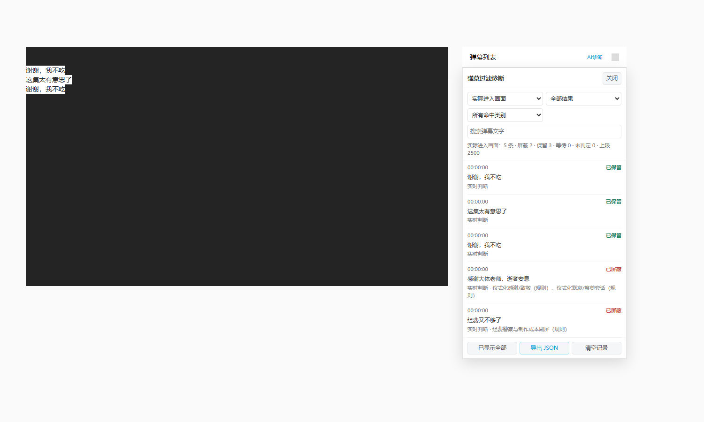

# Bilibili AI Danmaku Filter

A **local, CPU-based semantic danmaku filter for Bilibili** with 19 independently configurable categories, predictive filtering, and an in-sidebar diagnostics view.

**简体中文 | [English](README.en.md)**

> 当前公开发布准备版：v1.3.0（用户脚本） / v1.1.0（本地推理服务）。仓库目前可以作为私有项目使用；不依赖付费模型 API。项目为独立社区工具，与哔哩哔哩及 Google 无官方关联。



*上图是自动化测试使用的模拟 B 站页面，并非真实账户的截图。*

## 特性

- **本地模型推理**：基于 [Google EmbeddingGemma 2](https://huggingface.co/google/embeddinggemma-2) 的 270M 文本子模型，在 CPU 上运行。过滤文本不上传云端 AI API。
- **19 类独立过滤**：经费/作画刷屏、剧透暗示、前方高能、争吵、说教、拉踩、仪式化感谢等；可逐类开关、调整灵敏度、设置优先级更高的本地黑白名单。
- **弹幕不延迟出现**：待判定时原生弹幕保持可见；判定屏蔽后才隐藏。无法及时预判的目标弹幕可能短暂出现。
- **提前预判**：在当前视频的 6 分钟 protobuf 弹幕分段中，提前处理默认未来 22 秒的文本。实时出现的弹幕优先于预判队列。
- **不覆盖视频**：诊断入口位于 B 站右侧「弹幕列表」标题栏，不在视频画面添加悬浮按钮。
- **可解释的诊断**：查看当前页已屏蔽/保留/待判定弹幕、命中类别、规则或语义判定原因、播放时间；与尚未出现的预判记录分开统计，可检索、筛选并导出 JSON。
- **自动故障降级**：本地服务断开时恢复 B 站原生弹幕，不会长时间阻塞显示。
- **本机运行**：Python HTTP 服务只监听 `127.0.0.1:39683`；API 使用本地随机 Token，视频脚本以 Tampermonkey 运行。

## 架构

```text
Bilibili 视频播放器 / 普通文字弹幕 DOM
  │  ├─ 新弹幕到达 → 立即显示 → 优先分类队列
  │  └─ 当前视频 protobuf 分段 → 提前预判（低优先级）
  │
  ├── Tampermonkey 脚本 + 分类缓存 + 右侧诊断 UI
  │         │
  │         └─ GM_xmlhttpRequest + 本地认证 Token
  ▼
127.0.0.1:39683 / Python ThreadingHTTPServer
  ├─ 强规则、例外规则、黑白名单
  ├─ EmbeddingGemma 2（文本 270M，单次嵌入）
  └─ 19 类校准的参考向量与阈值
```

**兼容范围**：B 站桌面版普通视频、番剧、稍后再看页面中的常规 DOM 文字弹幕。BAS、高级动画弹幕、图片弹幕或未来 B 站 DOM 改版不保证全部支持。

## 安装（Windows）

需要 Python **3.12 / 3.13**、Git、Chrome + [Tampermonkey](https://www.tampermonkey.net/) 和足够的磁盘空间。下载 Google 原始模型约需数 GB 磁盘空间；提取出的文本权重约 **542MB**。第一次加载模型和初始化要比日常推理慢。

**1. 获取仓库和依赖**

```powershell
git clone https://github.com/oyasumiaiko/bilibili-ai-danmaku-filter.git
cd bilibili-ai-danmaku-filter

py -3.13 -m venv .venv
.\.venv\Scripts\python.exe -m pip install --upgrade pip
.\.venv\Scripts\python.exe -m pip install -r requirements.txt
```

如果 Python 安装器未提供 `py -3.13`，改用已安装的 Python 3.12/3.13 路径。CPU-only PyTorch 可先按 [PyTorch 官方安装说明](https://pytorch.org/get-started/locally/)安装，再安装其余依赖。

**2. 获取模型（权重不随 Git 仓库提供）**

```powershell
.\.venv\Scripts\python.exe scripts\download_model.py
.\.venv\Scripts\python.exe scripts\extract_text_only.py
```

此过程从 `google/embeddinggemma-2` 获取上游模型，并提取仅文本部分到 `models/embeddinggemma-2-text/`。如已有可用的文本专用模型目录，也可以设置 `AI_DANMAKU_MODEL_DIR` 环境变量直接指向它，跳过下载。

**3. 生成本机脚本和随机 Token**

```powershell
.\.venv\Scripts\python.exe browser_filter\build_userscript.py
```

它会在本地生成：

- `browser_filter/state/local_auth.json` — 私有认证 Token。
- `browser_filter/bilibili_ai_filter.user.js` — 内嵌上述 Token 的完整本机脚本。
- `browser_filter/bilibili_ai_filter_loader.user.js` — 指向当前电脑绝对 `file:///` 路径的 Tampermonkey 加载器。

**这三个文件都被 .gitignore 忽略，不能提交 Git 或公开分享。** 仓库只保存无密钥模板。

**4. 启动后台推理服务**

```powershell
.\.venv\Scripts\python.exe browser_filter\backend.py
```

另一个终端检查 `http://127.0.0.1:39683/health`。等待 `status: ready` 后即可使用。Windows 登录自动启动可以用 `scripts/install_windows_task.ps1`（可选，不是必要步骤）。

如果 `39683` 已被其他程序占用，可以改用另一端口，例如先执行 `python browser_filter/build_userscript.py --port 39733`，再执行 `python browser_filter/backend.py --port 39733`，重新导入生成的加载器。构建端口与后端监听端口必须相同。

**5. 安装 Tampermonkey 脚本**

在 Chrome 扩展管理中启用 Tampermonkey 的「允许访问文件网址」和必要的用户脚本权限。然后在 Tampermonkey 的「实用工具」中**导入生成的** `browser_filter/bilibili_ai_filter_loader.user.js`，不要同时安装两个完整脚本。

打开或刷新一个 B 站视频页面，即可在右侧「弹幕列表」旁看到小字「**AI诊断**」。过滤会在后台自动运行；在 Tampermonkey 菜单选择「AI 弹幕过滤：设置」调整规则。

### Linux / macOS

```bash
python3 -m venv .venv
. .venv/bin/activate
pip install -r requirements.txt
python scripts/download_model.py
python scripts/extract_text_only.py
python browser_filter/build_userscript.py
python browser_filter/backend.py
```

浏览器仍需能够访问同一台电脑的 `127.0.0.1`。Windows 计划任务脚本不适用于 Linux/macOS；可用系统的服务管理器另行启动。Linux/macOS 路径由本地脚本生成，无需手工编辑 `@require`。

## 分类设置与诊断

默认启用 19 类并采用 `high_recall` 档位，另有 `balanced`（偏 F1）、`aggressive`（进一步提高召回）与 `keywords_only`（不用模型）等档位。分类器采用人工编写的强规则、排除模式与正负参考向量；不是针对所有弹幕训练的监督式分类模型。

点击 B 站右侧的 **AI诊断** 按钮后：

- 「实际进入画面」按实际文字弹幕实例逐条记录。重复文字若出现两次则记录两次，区分**已屏蔽、已保留、待判定、未判定**。
- 「提前预判缓存」显示按文本去重的近期预判结果，**不能把它的屏蔽次数视为实际屏幕屏蔽次数**。
- 选择过滤结果和类别，输入关键词搜索；需要问题复现时点击「导出 JSON」。

诊断数据只在本标签页的内存里保存，最多保留 2,500 条实际弹幕与 1,800 条预判文本；切换视频会清空。播放时间是页面观察到弹幕的近似时间，不等同于完整视频的精确原始时间戳。

## 评测结果与限制

开发过程中人工审阅了 **687 条**弹幕，这些样本**同时参与了阈值和规则调节**。下表为样本内结果，**不是独立测试集精度，也不代表 B 站所有视频上的泛化表现**：

| 档位 | Precision | Recall | F1 |
| --- | ---: | ---: | ---: |
| balanced | 90.7% | 93.6% | 92.1% |
| high_recall | 86.5% | 96.2% | 91.1% |
| aggressive | 83.0% | 96.8% | 89.4% |

原始抓取数据、手动标注的第三方弹幕、浏览器个人资料、调试 HAR 和历史工程缓存**均不包含在此仓库**。不同视频/类别可能存在误判、漏判。

## 仓库结构

```text
assets/                   校准参数与约 1.1 MB 的参考向量
browser_filter/           HTTP 后端、油猴模板、右侧诊断与本地构建器
config/                   19 类规则与参数示例
docs/                     原理、设置与隐私说明
scripts/                  推理脚本、模型下载/文本权重提取、Windows 自动启动
tests/                    无模型离线测试与可选浏览器集成测试
.github/workflows/ci.yml  离线 CI（不下载模型、不访问 B 站）
```

详细说明：[安装排障](docs/TROUBLESHOOTING.md) · [架构与数据流](docs/ARCHITECTURE.md) · [隐私与数据](docs/PRIVACY.md) · [English README](README.en.md)

## 安全与许可

项目代码使用 [MIT License](LICENSE)。Google EmbeddingGemma 2 是独立的上游模型，模型许可与权重版权归其相应权利人所有（见 [NOTICE](NOTICE)），模型文件不在此仓库中。哔哩哔哩的网页、接口和商标不属于本项目。

请勿上传生成的本机 Token、用户脚本、浏览器个人资料、抓取的完整弹幕或包含凭证的日志。漏洞报告方式见 [SECURITY.md](SECURITY.md)。

欢迎提交不含隐私数据的 Issue/PR；见 [CONTRIBUTING.md](CONTRIBUTING.md)。
